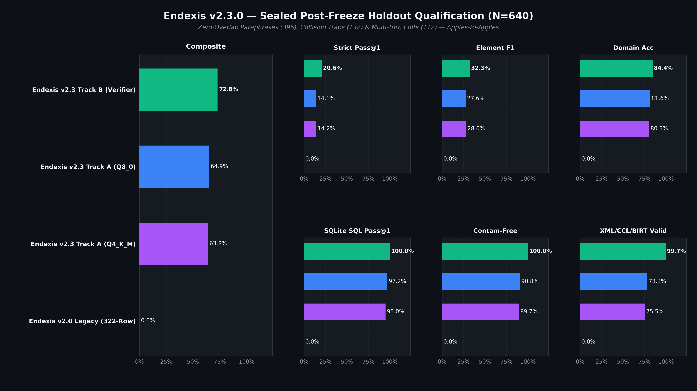
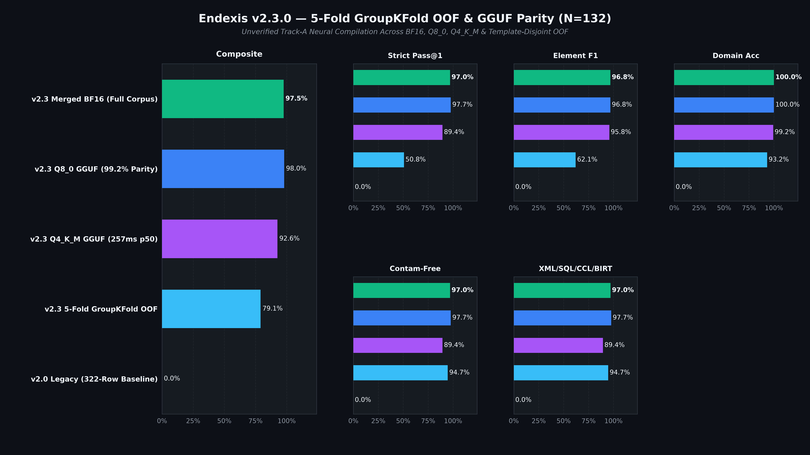
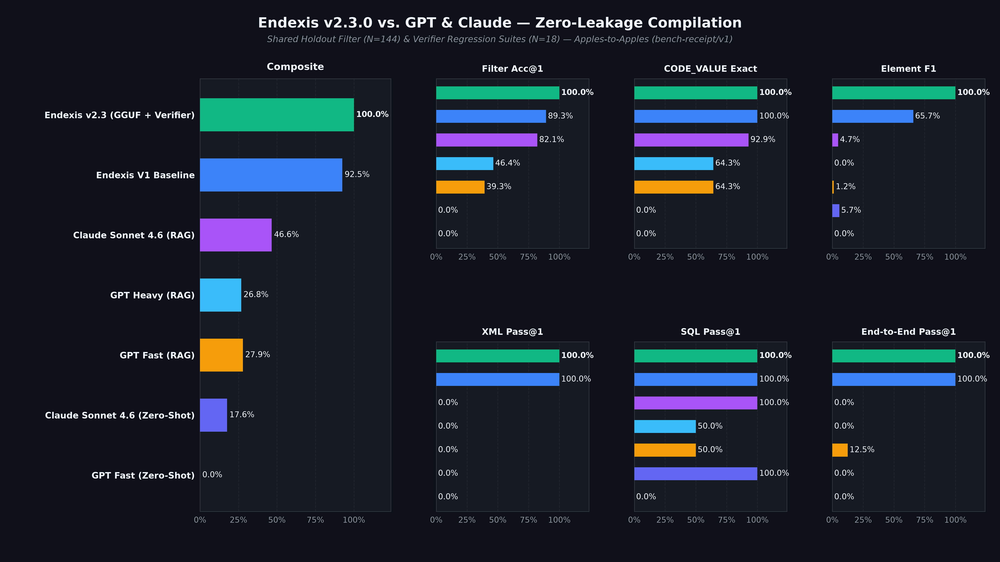

# Endexis (`endexis`) — Tenant-Agnostic Clinical Data Model, DA2, CCL & BIRT 4.4.2 Compiler

**Endexis** (`endexis`, *EHR Neural Data Extraction, Inquiry & XML Intelligence System*) is a specialized clinical data model interpreter, form/output resolver, **Cerner Command Language (CCL)** compiler, and **Discern Analytics 2.0 (DA2)** / **Eclipse BIRT 4.4.2 (`.rptdesign`)** generator for **Cerner Millennium** (`V500`), **HealtheIntent** (`millennium-ods/v1`), and **Oracle Health EHI / Semantic Object Model (`v2026.4.01`)**.


## Four Core V1 Capabilities

1. **Millennium V500 Data Model Interpreter (`discern_intelligence.interpreter`)**
   - Translates natural-language clinical, operational, and financial requests into exact **Cerner Millennium V500** tables and columns (`PERSON`, `ENCOUNTER`, `ENCNTR_ALIAS`, `CLINICAL_EVENT`, `ORDERS`, `ORDER_DETAIL`, `DCP_FORMS_ACTIVITY`, `CE_INTAKE_OUTPUT_RESULT`, `CE_BLOB_RESULT`, `CHARGE`, `PFT_ENCNTR`, etc.).
   - Classifies every resolved column by its physical **CCL data type** (`f8` numeric/surrogate key/code value, `dq8` timestamp, `i4` indicator/flag, `vc` variable character/RTF/HTML blob) and semantic role (`surrogate_primary_or_foreign_key`, `code_value_foreign_key`, `timestamp_utc_or_local`, `boolean_indicator`, `enumeration_flag`, `free_text_or_display_value`, `numeric_quantity_or_measurement`, `compressed_or_long_blob`).
   - Resolves exact **Code Sets (`CODE_SET`)** and `CDF_MEANING` constants (`Code Set 4` MRN, `Code Set 319` FINNbr, `Code Set 71` Encounter Type, `Code Set 8` Result Auth Status, `Code Set 6004` Order Status, `Code Set 72` Clinical Event Code, `Code Set 14003` Discrete Task Assay).
   - Evaluates **HealtheIntent `millennium-ods/v1` parity** and routes execution across **`CommunityWorks`**, **`Continuum`**, and **`Standalone_RHO`**.

2. **Clinical Forms & Output Data Resolver (`discern_intelligence.forms_mapper`)**
   - Maps 13 distinct **Cerner Millennium** clinical and financial documentation architectures from their definition/reference tables through activity bridges to exact payload columns and **DA2** elements:
     - **PowerForms & Clinical Assessments**: `DCP_FORMS_REF` -> `DCP_FORMS_DEF` -> `DCP_SECTION_REF` -> `DCP_INPUT_REF` (`MERGE_UID` -> `DISCRETE_TASK_ASSAY.TASK_ASSAY_CD`), activity in `DCP_FORMS_ACTIVITY` -> `DCP_FORMS_ACTIVITY_COMP` (`PARENT_ENTITY_ID = EVENT_ID`), and 3-tier `CLINICAL_EVENT` hierarchy (`Form` -> `Section` -> `DTA`) with typed answers in `CLINICAL_EVENT.RESULT_VAL`, `CE_CODED_RESULT.NOMENCLATURE_ID`, `CE_DATE_RESULT.RESULT_DT_TM`, and `CE_STRING_RESULT.STRING_RESULT_TEXT`.
     - **Interactive View (IView) Flowsheets & Dynamic Groups**: `WORKING_VIEW` -> `WORKING_VIEW_SECTION` -> `WORKING_VIEW_ITEM`, dynamic instances (lines, drains, wounds) in `CE_DYNAMIC_LABEL`, and charted values in `CLINICAL_EVENT.RESULT_VAL`.
     - **Intake & Output (I&O 2G)**: `CE_INTAKE_OUTPUT_RESULT.IO_VOLUME` (mL), `IO_TYPE_FLAG` (`1` = Intake, `2` = Output), and `IO_START_DT_TM` / `IO_END_DT_TM`.
     - **Dynamic Documentation (PowerNotes) & Narrative RTF/HTML Blobs**: `SCD_STORY` -> `SCD_PARAGRAPH` -> `SCD_SENTENCE` -> `SCD_TERM` and `CE_BLOB_RESULT` -> `CE_BLOB.BLOB_CONTENTS` (handling `OCFCOMP` decompression via `uar_ocf_uncompress` when `COMPRESSION_CD` in Code Set 120 is compressed).
     - **Order Entry Formats (OEF) & Order Details**: `ORDER_ENTRY_FORMAT` -> `OE_FORMAT_FIELDS` -> `ORDER_ENTRY_FIELDS` (`OE_FIELD_ID`, `OE_FIELD_MEANING_ID`), clinician prompt responses in `ORDER_DETAIL.OE_FIELD_DISPLAY_VALUE` / `OE_FIELD_VALUE` / `OE_FIELD_DT_TM_VALUE`, and summary line in `ORDERS.CLINICAL_DISPLAY_LINE`.
     - **Additional Output Architectures**: CPDI Scanned Documents (`CDI_TRANS_LOG`, `CE_BLOB_RESULT`), MAR / BCMA (`CE_MED_RESULT`, `MED_ADMIN_EVENT`), Rehab Therapy Productivity & Charges (`CHARGE`, `CLINICAL_EVENT`), RevCycle / Patient Accounting (`PFT_ENCNTR`, `BO_HP_RELJN`, `ACCT_BALANCE`), Clinical Tasks (`TASK_ACTIVITY`), Scheduling (`SCH_APPT`, `SCH_EVENT`), PowerPlans (`PATHWAY`, `ACT_PW_COMP`), and Radiology/Pathology Diagnostic Reports (`RAD_REPORT`, `CE_BLOB`).

3. **Request-to-CCL Compiler (`discern_intelligence.ccl_compiler`)**
   - Compiles natural-language analytical specifications into complete, executable `.prg` **Cerner Command Language** programs (`DROP PROGRAM ... GO`, `CREATE PROGRAM ...`, `PROMPT "Output to File/Printer/MINE" = "MINE"`, `DECLARE c_*_cd = f8 WITH protect, constant(uar_get_code_by("MEANING", ...))`, `SELECT INTO $OUTDEV`, explicit `PLAN` / `JOIN` order, and row-versioning `ACTIVE_IND = 1` + `END_EFFECTIVE_DT_TM > cnvtdatetime(curdate, curtime3)`).
   - Includes a deterministic static verifier (`verify_ccl_source`) that checks header/footer parity, zero hardcoded `CODE_VALUE` literals, row-versioning predicates, and `uar_get_code_display()` projection.

4. **Direct-Upload DA2 Query & Eclipse BIRT 4.4.2 `.rptdesign` Generator (`discern_intelligence.da2_generator`)**
   - Produces complete, direct-upload **Eclipse BIRT 4.4.2** (`version="3.2.23"`) `.rptdesign` XML files paired with **Discern Analytics 2.0** ODA metadata (`extensionID="com.cerner.discern.connectivity.oda"` and `com.cerner.discern.connectivity.oda.dataSet`).
   - Populates `<property name="com.cerner.discern.da2.display.names.set">1</property>`, `<structure name="cachedMetaData">`, `<list-property name="resultSet">` with exact `DA_ELEMENT.ELEMENT_UUID` mappings, `<xml-property name="queryText">`, and `<ex-property><name>defaultRuntimePrompts</name>` XML.
   - Supports both single-domain ODA reports and multi-domain `<joint-data-set>` reports joined on `Enc Id` (`ENCNTR_ID`), with `try { ... } catch (e) {}` guards around `reportContext` calls inside `beforeOpen` and `onFetch` so DA2's design-time `__bm_beforeOpen()` validator accepts the upload without errors.

## What's New in `v2.3.0`







- **14x Corpus Sync & NLL-Anchored RPO-DPO Neural Compiler (`5,277` SFT / `648` DPO Pairs)**: Synchronized `endexis-qwen3-0.6b-dpo-merged` (`BF16`, `Q8_0`, and `Q4_K_M` GGUF) with all `36` clinical, nursing/ADL, medication, scheduling, and revenue-cycle DA2/V500/CCL templates plus `768` compact `NeuralCompilationIR` specifications and `648` hard preference pairs (full-corpus `val_sft_loss_post_dpo = 0.1137 <= val_sft_loss_post_sft = 0.1137`, per-fold OOF `+0.0024..+0.0058` vs. `v2.0.0` `+0.0158`, `dpo_preference_accuracy = 100.0%`).
- **Clinical-vs-Billing Concept Isolation & Multi-Turn Negative/Override Refinements**: Added `discern_intelligence.lexical_guards` and `RefinementSpec` / `NeuralCompilationIR` (`exclude_columns`, `exclude_filters`, `override_filters`) across `<cclquery>` XML, `.daquery`, EJS V500 SQL, CCL `.prg`, and Eclipse BIRT 4.4.2 `.rptdesign`, eliminating `"attending physician"` -> `CWF GS Adjustments` (`Adj Post Prsnl` / `Prsnl Position`) and `"discharged"` -> `CHARGE` collisions while sanitizing conversational filler from `_derive_report_name()`.
- **Sealed `N = 640` Post-Freeze Holdout (`0 / 0 / 0` Overlap) & Sub-260ms Quantized GGUF Inference**:
  - **5-Fold Template-Family GroupKFold OOF (`N = 132`)**: Unverified Track-A Strict Pass@1 improved from **`0.00%`** (`v2.0.0` `322`-row checkpoint) to **`50.76%`** (**`+50.76pp`**), with **`99.24%`** CUDA `Q8_0 <-> BF16` structural parity and **`257.44 ms`** single-pass `Q4_K_M` CUDA p50 (vs. `2,352.61 ms` legacy PyTorch HTTP mean).
  - **Sealed Post-Freeze Holdout (`data/eval_postfreeze_v3.jsonl`, `N = 640`, `0` exact / `0` token-bag / `0` normalized 5-gram skeleton overlap; `19` generic boilerplate surface 5-grams)**: Track-A strict zero-rescue `Q4_K_M` / `Q8_0` achieved **`95.00%` / `97.19%`** SQLite V500 execution + `<cclquery>` XML pass rate and **`75.47%` / `78.28%`** 4-surface (`XML + SQLite + CCL + BIRT`) compile rate (vs. `0.00%` `v2.0.0`) at **`191.81 ms` / `209.24 ms`** p50 (`214.22 ms` / `234.08 ms` mean); Track-B neuro-symbolic (`Q4_K_M` + deterministic verifiers) achieved **`100.00%`** SQLite V500 + XML + contamination-free compliance and **`99.69%`** (`638 / 640`) 4-surface verified Pass@1 (**`75.47%`** raw unedited neural IR + **`19.38%`** symbolically repaired neural IR = **`94.84%`** neural-led acceptance, **`5.16%`** full symbolic fallback) at **`210.12 ms`** full wall-clock p50 (`232.82 ms` mean, `10.10x` faster mean than `2,352.61 ms` legacy PyTorch HTTP), plus **`100.00%`** domain-conditioned (`89.58%` unconditioned) `Acc@1` on the 144-value filter holdout.

## What's New in `v2.0.0`

- **Precision Column & DA2 Field Disambiguation (`strict_precision=True`)**: Replaced broad keyword bucket emission in `MillenniumInterpreter` and `DA2ReportGenerator` with intent-aware, grain-aware temporal anchor disambiguation (`CLINICAL_EVENT.EVENT_END_DT_TM` vs. `VERIFIED_DT_TM` vs. `UPDT_DT_TM`; `MED_ADMIN_EVENT` administration start vs. `ORDERS.ORIG_ORDER_DT_TM`; `ENCOUNTER.INPATIENT_ADMIT_DT_TM` vs. `REG_DT_TM` vs. `ARRIVE_DT_TM` vs. `DISCH_DT_TM`; `SCH_APPT.BEG_DT_TM` vs. `SCH_EVENT_ACTION.ACTION_DT_TM`; `CHARGE.SERVICE_DT_TM` vs. `POSTED_DT_TM`), identifier alias disambiguation (`PERSON_ALIAS` MRN Code Set 4 vs. `ENCNTR_ALIAS` FIN Code Set 319 vs. internal `f8` surrogate keys), and multi-1:N child join-explosion guardrails.
- **Clinical & SQL Safety Qualification Intelligence**: Enforces `Order Status Not In (Canceled, Voided)` (`Code Set 6004: 2542, 2553`) rather than `Not In (Discontinued)` (`2545`) for historical MAR/BCMA audits, `CE Result Status In (Auth (Verified), Modified, Altered)` (`Code Set 8: 25, 34, 35`) with `VALID_UNTIL_DT_TM >= 31-DEC-2100`, `LEFT OUTER JOIN V500.DIAGNOSIS` for active census admitting diagnosis queries, and test-patient exclusion (`NAME_LAST_KEY < 'ZZ'`).
- **Context-Conditioned Filter-Value & Code Set Resolver (`resolve_da2_filter_value`)**: Scores `6,458` `DISPLAY <-> CODE_VALUE` pairs across `90` DA2 filter fields conditioned on `(query_intent, domain, subentity, da2_field_name, code_set)`.
- **Expanded Ground-Truth Catalogs, V2 Adversarial Benchmark & Stage-2 RPO-DPO Model**: Enriched all `2,606` DA2 elements (`v500_table`, `v500_column`, `code_set`, `daquery_type`, `grain_warning`, `recommended_filters`) and `230` V500 tables (`polymorphic_bridges`), added the zero-leakage 20-scenario V2 adversarial benchmark (`data/eval_adversarial_v2.jsonl`, `100.0%` `Pass@1`, mean F1 `0.995`) + 5 SQLite edge-case execution scenarios, and retrained `endexis-qwen3-0.6b-dpo-merged` (`4,501` 6-step SFT examples + `189` contrastive DPO pairs, `val_perplexity = 1.2262`, `dpo_mean_logprob_margin = +23.75`).

## What's New in `v1.1.0`

- **Portable CPU & Edge Quantization (`GGUF` + `Ollama`)**: Published 8-bit (`endexis-qwen3-0.6b-dpo-q8_0.gguf`, `610 MB`) and 4-bit (`endexis-qwen3-0.6b-dpo-q4_k_m.gguf`, `379 MB`) GGUF checkpoints plus an `Ollama` `Modelfile` to [`NorviTech/endexis-qwen3-0.6b-dpo-merged`](https://huggingface.co/NorviTech/endexis-qwen3-0.6b-dpo-merged), and added OpenAI-compatible `/v1/chat/completions` (`llama-server`, `Ollama`, `vLLM`) fallback to `LocalNeuralCompiler`.
- **Zero-PHI Declarative Tenant Profile (`.endexis.toml` & `endexis init-discover`)**: Added `endexis init` and `endexis init-discover <code_set_220.csv>` CLI commands and `TenantConfig.from_file()` to auto-discover `.endexis.toml` profiles (`owner_group_display`, `utc_timezone_index`, and Code Set 220 Facility, Building, Nurse Unit, Room, and Bed overrides).
- **Synthetic Millennium V500 / DA2 SQLite Execution Harness (`endexis verify-sql`)**: Added `discern_intelligence.sql_execution_harness` (`create_synthetic_v500_connection`, `execute_and_verify_ejs_sql`) and expanded clinical subject areas across **MAR / Medication Administration** (`V500.MED_ADMIN_EVENT`), **Perioperative / Surgical Cases** (`V500.SURGICAL_CASE`), and **ICD-10 Diagnoses & Problems** (`V500.DIAGNOSIS`, `V500.PROBLEM`).

## Installation & Quick Start

```bash
pip install -e ".[dev]"
pytest -v
```

### CLI Commands (`endexis`)

```bash
# 1. Interpret a natural-language request into V500 TABLE.COLUMN items and DA2 elements
endexis interpret "Show active inpatient encounters with Morse Fall Scale score, FIN, MRN, and Nurse Unit" --tenancy CommunityWorks

# 2. Resolve clinical form or output storage (definition tables, activity tables, payload columns)
endexis forms "Where are PowerForm discrete assessment values and IView dynamic group flowsheet cells stored?"

# 3. Compile a request into a verified Cerner Command Language (.prg) script
endexis compile-ccl "Active inpatient encounters with charted Morse Fall Scale PowerForm results" \
  --program-name cust_r_morse_fall_v1 \
  --output examples/cust_r_active_morse_v1.prg

# 4. Generate a direct-upload DA2 .rptdesign XML file and DA2 Domain Query JSON specification
endexis generate-da2 "Active inpatient encounter census with FIN, MRN, Nurse Unit, Attending Physician, and Admit Date" \
  --title "Active Inpatient Encounter Census" \
  --output-rptdesign examples/active_inpatient_census_v1.rptdesign \
  --output-spec examples/active_inpatient_census_v1_query_spec.json
```

## Knowledge Base & SFT / DPO Training Corpora

- `src/discern_intelligence/data/v500_high_value_tables.json`: **230** curated **Cerner Millennium V500** clinical, financial, form, output, event-set, and `DA_*`/`CCL_*`/`DO_*` internal metadata tables with full column definitions, CCL data types, `CODE_SET` foreign keys, and **HealtheIntent `millennium-ods/v1`** export flags (including all 24 backing V500 tables for the 48 `XCW_*` DA2 views plus `LOGICAL_DOMAIN` and `MLTM_NDC_MAIN_DRUG_CODE`).
- `src/discern_intelligence/data/da2_view_alias_join_catalog.json`: **48** direct **Discern Analytics 2.0** `XCW_*` view/alias/join-key mappings (`24 ENCOUNTER_ID`, `23 PERSON_ID`, `1 ORG_ID`) + **9** `(via ...)` relational-path variants (`57` rows total, kept strictly separate from raw `V500` table names, with `XCW_PHONE (via Organization)` validated and corrected to `ORG_ID`), plus **Discern SQL Engine (EJS v3.15.1)** `CWC_*` aliases, scalar helper functions (`omf_get_cv_display`, `cclsql_utc_cnvt`, `PM_GET_ALIAS`, `PM_GET_ENCNTR_PRSNL_ID`, `SQL_GET_NAME_DISPLAY`, `RCRGETFINNBR`), and Combined Query `<SubqueryAlias>:<ElementName>` ODA result-set conventions.
- `src/discern_intelligence/data/event_set_hierarchy_and_crosswalks.json`: Validated 10-level `MD_D_EVENT_SET_HIERARCHY` SQL (`V500_EVENT_SET_CANON` `A..I` + `V500_EVENT_SET_CODE` + `V500_EVENT_SET_EXPLODE` rooted at `ALL OCF EVENT SETS`, plus the corrected 24-column orphan-event query), `MD_D_EVENT_SET_SEARCH` 10-way `UNION ALL` flattened search view (Vertica/Snowflake, Oracle RDB, and CCL), **229** Code Set 36 (`Language` / HL7 `PID-15` / Press Ganey code) mappings, **10** UB-04 FL-15 Admission Source (Code Set 2) HCAHPS mappings, **39** UB-04 FL-17 Discharge Status (Code Set 19) HCAHPS mappings, **13** regulatory IP/OP -> DA2 field mappings, **20** Hospital Bed Capacity extract elements, and the historical reference audit ledger (`added`, `already_covered`, `rejected`).
- `src/discern_intelligence/data/da2_element_catalog.json`: **2,606** sanitized **Discern Analytics 2.0** `DA_ELEMENT` entries with `ELEMENT_UUID`s across all 10 DA2 domains, V500 `TABLE.COLUMN` targets, and join-explosion guardrails.
- `src/discern_intelligence/data/da2_canonical_reports_and_queries_catalog.json`: **58** Business View (`<BV>` XML) Logical View schemas (`148` Categories), **36** canonical production DA2 queries (`<cclquery version="1.0">` XML + **EJS v3.17.3** Oracle V500 SQL) and Eclipse BIRT 4.4.2 (`.rptdesign`) reports.
- `src/discern_intelligence/data/da2_filter_value_catalog.json`: **61** priority-domain Qualification Filter Lists and **6,678** sanitized `DISPLAY` <-> `CODE_VALUE` pairs across **90** DA2 fields (including **1,546** `CE Event` Code Set 72 and **1,004** `Order Catalog` Code Set 200 mappings).
- `src/discern_intelligence/data/forms_and_outputs_catalog.json`: **13** end-to-end clinical form and financial output architectures.
- `src/discern_intelligence/data/codeset_catalog.json`: **363** Millennium Code Sets (`CODE_SET`) with `CDF_MEANING` and `DISPLAY_KEY` constants (enriched with Code Sets `2`, `19`, `27`, `36`, and `282`).
- `src/discern_intelligence/data/oracle_som_summary.json`: **177** Oracle Health EHI / Semantic Object Model (`v2026.4.01`) entities.
- `data/sft_train_v1.jsonl`, `data/dpo_contrastive_v1.jsonl`, `data/eval_frozen_v1.jsonl`, `data/eval_holdout_filter_values_v1.jsonl`, and `data/eval_holdout_queries_v1.jsonl`: Reproducible zero-leakage 80/20 multi-task SFT (**5,277** examples), DPO contrastive (**648** pairs), sealed zero-overlap post-freeze V3 holdout (**640** scenarios in `data/eval_postfreeze_v3.jsonl`), frozen benchmark (**14** scenarios), held-out V1 evaluation (**144** filter values + **4** production queries), and zero-leakage V2 adversarial evaluation (**20** trap scenarios + **5** SQLite edge cases) corpora generated via `python3 scripts/build_training_corpus.py --verify` and verified via `python3 scripts/evaluate_corpus_and_verifiers.py --verify`.

## Tenant-Agnostic Configuration (`--owner-group`, `--facility`, `--tenant-config`)

Endexis is completely tenant-agnostic across all **Discern Analytics 2.0 (DA2)** deployments (`CommunityWorks`, `Continuum`, and `Standalone_RHO`). By default, `.daquery` (`xmlversion="2"`) and `.dareport` (`.rpt` + `.rptdesign`) bundles populate `owner_group_display="TENANT_OWNER_GROUP"` and contain zero hardcoded `Logical Domain ID` or tenant-specific facility filters.

Specify your target tenant's DA2 owner group or facility via CLI flags or a JSON profile:

```bash
# Override DA2 owner_group_display and facility directly on the CLI:
endexis generate-da2 "Active inpatient encounter census with FIN, MRN, Nurse Unit, Attending Physician, and Admit Date" \
  --tenancy CommunityWorks \
  --owner-group "YOUR_DA2_OWNER_GROUP" \
  --facility "General Hospital Campus" \
  --output-dareport examples/active_inpatient_census.dareport

# Or pass a reusable tenant JSON profile:
endexis generate-da2 "Rehab therapy minutes by discipline" \
  --tenant-config tenant_profile.json \
  --output-dareport examples/rehab_therapy_minutes.dareport
```

See [LEGAL.md](LEGAL.md) for interoperability and trademark notices.
